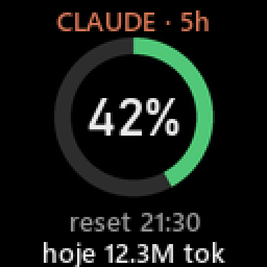
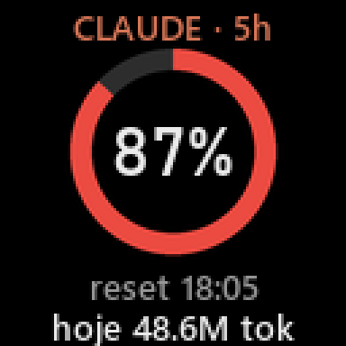

<p align="center">
  
</p>

<h1 align="center">clak820</h1>

<p align="center">
  O consumo do <b>Claude Code</b> na telinha do teclado <b>AJAZZ AK820 Pro</b>.<br>
  <sub><b>CL</b>aude + <b>AK820</b>, e o <i>clack</i> do teclado mecânico.</sub>
</p>

<p align="center">
  
  &nbsp;&nbsp;
  
</p>

## O que aparece na tela

- **% usado da janela de 5 horas**: o anel fica verde, amarelo a partir de 50% e vermelho a partir de 80%
- **horário do reset** da janela
- **tokens usados hoje**, somados dos logs locais do Claude Code

Sem atividade no Claude Code por 20 minutos, a tela volta ao **relógio nativo** do teclado, já com a hora acertada.

> Requer conta **Claude Pro ou Max**. O Claude Code só informa os limites de uso para assinantes.

## Instalação

1. Baixe o **`clak820-<versão>-setup.exe`** em [**Releases**](../../releases) e dê dois cliques.
2. Conecte o teclado **pelo cabo USB, no modo com fio**, e feche o app oficial da AJAZZ.
3. No fim da instalação, deixe marcado **Executar clak820**.

Pronto. O ícone do clak820 aparece na bandeja, perto do relógio do Windows. Na primeira vez ele:

- configura o `statusLine` do Claude Code em `~/.claude/settings.json`, com backup em `settings.json.bak-clak820`;
- passa a iniciar junto com o Windows.

Não precisa de terminal nem de administrador. Para remover, use **Configurações → Aplicativos → clak820 → Desinstalar**, que também desfaz o statusLine e a inicialização automática.

> O Windows SmartScreen pode avisar na primeira execução, porque o instalador não é assinado.
> Clique em **Mais informações → Executar assim mesmo**.

<details>
<summary>Versão portátil (.zip, sem instalador)</summary>

Extraia o `clak820-<versão>-windows-x64.zip` numa pasta fixa e abra o `clak820.exe`.
A configuração é a mesma. Para remover, rode `clak820-cli.exe uninstall` e apague a pasta.
</details>

## Bandeja

O ícone mostra o anel do % de 5h com a mesma cor da tela. Clique com o botão direito para ver:

```
5h: 25%  ·  reset 19:50
Hoje: 7.33M tokens
Teclado: cabo ✓
─────────────────────────
Atualizar tela agora
Pausar (mostrar relógio)
✓ Iniciar com o Windows
Abrir pasta de logs
Sobre o clak820
─────────────────────────
Sair
```

## Linha de comando

O `clak820-cli.exe` tem os mesmos recursos para quem prefere o terminal:

| Comando | O que faz |
|---|---|
| `install` / `uninstall` | Configura ou remove tudo |
| `status` | Mostra o app, o statusLine, a inicialização automática e o modo do teclado |
| `start` / `stop` | Abre ou fecha o app da bandeja |
| `clock` | Acerta a hora e volta a tela ao relógio nativo |
| `upload [imagem]` | Envia qualquer imagem para a tela (ou o painel, sem argumento) |
| `render --demo --scale 3 --out p.png` | Gera o painel como PNG, sem enviar |
| `probe` | Lista as interfaces USB do teclado (só leitura) |
| `run -v` | Roda o daemon no terminal, para depurar |

## Como funciona

```
Claude Code ──statusLine (JSON)──▶ clak820-cli statusline ──▶ state.json ─┐
~/.claude/projects/**/*.jsonl ───────────────────────────────────────────────┤
                                                                             ▼
                  clak820.exe (bandeja) ── desenha 128×128 ──▶ USB HID ──▶ tela
```

- Os limites vêm do campo oficial `rate_limits` que o Claude Code entrega ao
  [statusLine](https://code.claude.com/docs/en/statusline). O statusLine também mostra no próprio
  Claude Code algo como `Opus · 5h 25% (reset 19:50) · sem 11%`.
- **A tela é atualizada só quando algo muda, no máximo a cada 5 minutos.** Cada envio grava na
  memória flash do teclado, que tem vida útil limitada.
- Dados e log ficam em `%LOCALAPPDATA%\clak820\`. Para ajustar os tempos, crie um `config.json` lá:

  ```json
  { "min_interval_s": 300, "idle_after_s": 1200 }
  ```

## Limitações

- **Só funciona no modo com fio.** Com o firmware original:
  - no **Bluetooth**, o cabo vira só carregador: o Windows vê apenas `0C45:FEFE`, sem interface de configuração;
  - no **2.4 GHz**, o receptor `0C45:FDFD` não tem comando de tela.

  Nesses modos o daemon só espera e volta a atualizar quando o teclado estiver no cabo.
- Testado no AK820 Pro com tela TFT (`0C45:8009`). Variantes com outro protocolo
  (usage page `0xFF67`) não são suportadas.

## Protocolo

USB `0C45:8009`, com MCU SONiX.

- **Comandos:** feature reports de 64 bytes na interface `0xFF13`, no formato `04 cmd arg … count`.
- **Imagem:**
  1. `BEGIN 0x18`
  2. `SCREEN 0x72`, com o número de blocos
  3. blocos de 4096 bytes na interface `0xFF68`: header de 256 bytes seguido dos frames RGB565 little-endian. O teclado confirma cada bloco com `01 5A 02`.
  4. `COMMIT 0x02`

Tudo está em [`clak820/protocol.py`](clak820/protocol.py).

Engenharia reversa feita pela comunidade:
[deddroid/ak820-rs](https://github.com/deddroid/ak820-rs) ·
[imgunjan/ak820-linux-studio](https://github.com/imgunjan/ak820-linux-studio) ·
[nurlanjalil/ajazz-ak820-config](https://github.com/nurlanjalil/ajazz-ak820-config) ·
[gohv/EPOMAKER-Ajazz-AK820-Pro](https://github.com/gohv/EPOMAKER-Ajazz-AK820-Pro)

## Desenvolvimento

```powershell
pip install -e ".[dev]"
python -m pytest
python -m clak820 tray        # abre o app da bandeja pelo Python
```

Gerar os executáveis, o `.zip` e o instalador em `dist\` (precisa do
[Inno Setup 6](https://jrsoftware.org/isinfo.php): `winget install JRSoftware.InnoSetup`):

```powershell
.\build.ps1
```

Para publicar uma versão, crie uma tag `v*`, como `git tag v0.1.0` seguido de `git push --tags`.
O GitHub Actions gera o instalador e o `.zip` e publica os dois em Releases.

## Licença

MIT. Projeto não oficial, sem relação com a AJAZZ ou a Anthropic. Use por sua conta e risco.
